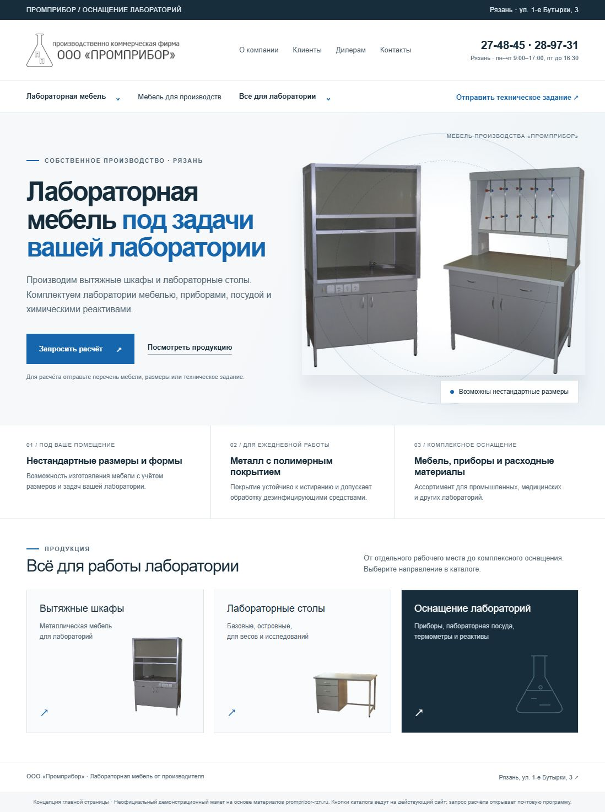

# Промприбор — концепция главной страницы

Независимый демонстрационный макет, подготовленный 29 октября 2026 года на основе открытых материалов https://www.prompribor-rzn.ru/ . Не является официальным сайтом ООО «Промприбор».

## Просмотр

[Открыть макет](https://maxprosh.github.io/prompribor-homepage-concept/)

`prompribor-homepage.html` — автономный файл: стили и оригинальные фотографии встроены. `index.html` — его копия для GitHub Pages. Макет можно скачать и открыть без подключения к интернету; переходы в каталог и почтовую программу требуют внешних приложений/сети.

## Источники и ограничения

- Логотип: https://www.prompribor-rzn.ru/images/logo.png
- Фото первого экрана: https://www.prompribor-rzn.ru/images/backshot.jpg
- Вытяжной шкаф: https://www.prompribor-rzn.ru/images/primer.jpg
- Стол: https://www.prompribor-rzn.ru/images/stories/stoli-pismennie/z_dfb72df9-2.jpg
- Свойства мебели, нестандартные размеры и комплексное оснащение: главная страница исходного сайта.
- Контакты: https://www.prompribor-rzn.ru/контакты

Материалы принадлежат их правообладателям и используются для демонстрации предложения по обновлению сайта. Утверждения исходного сайта не являются независимой проверкой свойств продукции. Сроки изготовления, сертификаты, цены изделий и гарантии в макете не заявлены. Указание «20 лет» и старую ссылку на ГОСТ намеренно не переносили без актуального подтверждения.

Кнопки каталога ведут на действующий сайт. Запрос расчёта открывает почтовый клиент, серверной формы и отправки заявки в макете нет. Макет не содержит аналитики и не собирает данные посетителей. Перед внедрением согласовать содержание с владельцем и подключить выбранный способ обработки заявок.

## Дизайн

Технический светлый стиль: акцент #1666AE, текст #172D3B, фон #F5F7F8. Arial/Helvetica, крупный заголовок и предметное фото; приоритет — продукт → состав поставки → запрос расчёта. Исходный логотип сохранён.
